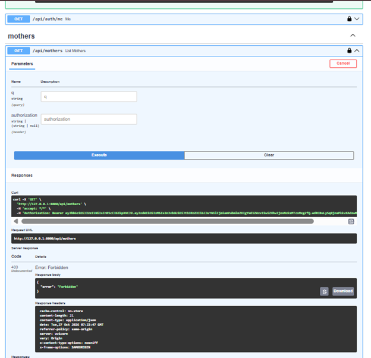
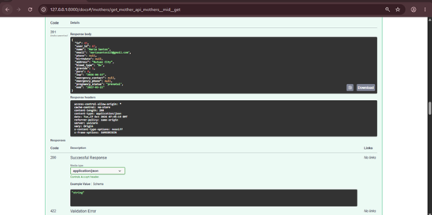
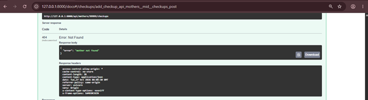
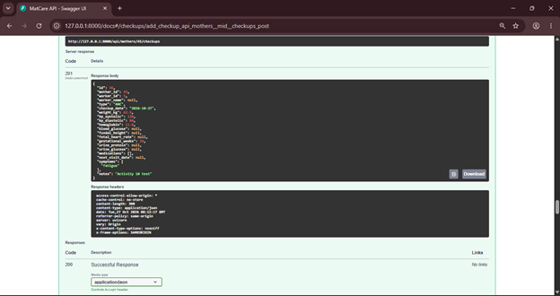

# Activity 10 — Error Resolution Log

## Error 1: Insufficient Permissions (403 Forbidden)

### A - Before Fix

* **Figure E01-BEFORE:** `GET /api/mothers` returning `403 Forbidden`.
* **Issue:** Attempted to access the mothers list using a "mother" role token, which lacks the required privileges.

### B - Diagnose
* **Cause:** The endpoint is protected by FastAPI's role-based access control (RBAC). The API rejected the request because the authenticated user's role (mother) is not included in the allowed roles (worker, admin). This proves the system's authorization is working correctly.

### C - After Fix

* **Figure E01-AFTER:** `GET /api/mothers/45` returning `201 Created` after authorizing with an Admin role.
* **Fix:** Logged in again using the `admin@gmail.com` account to obtain a valid Admin JWT. Updated the Swagger Authorize token. Then, successfully retrieved a specific mother's record to verify access.
* **Response:** `201 Created` with the correct data for "Maria Santos" (ID 45).

### D - Record
* **Committed to GitHub with commit message:** `docs(activity10): add error resolution log E01`
* **Commit ID:** `c4c291c`

---

## Error 2: Invalid Reference ID — mother not found (404)

### A - Before Fix

* **Figure E02-BEFORE:** `POST /api/mothers/99999/checkups` returning `404 Not Found`.
* **Issue:** Submitted a checkup for mother ID 99999, an ID that does not exist in the `mother_profiles` table.

### B - Diagnose
* **Cause:** The checkup route (`api/routers/checkups.py`, `add_checkup`) verifies that the mother exists before inserting into the checkups table. When the lookup fails it returns `404 {"error": "mother not found"}`.
* **Note:** MatCare validates the reference in application code, so a would-be PostgreSQL foreign-key violation is converted into a clean 404 instead of a 500. This is a deliberate design decision.

### C - After Fix

* **Figure E02-AFTER:** `POST /api/mothers/45/checkups` returning `201 Created`.
* **Fix:** Called `GET /api/mothers` first to obtain a real mother ID (45), then used that ID in the path and re-executed with a valid ANC payload.

### D - Record
* **Committed to GitHub with commit message:** `docs(activity10): add error resolution log E02`
